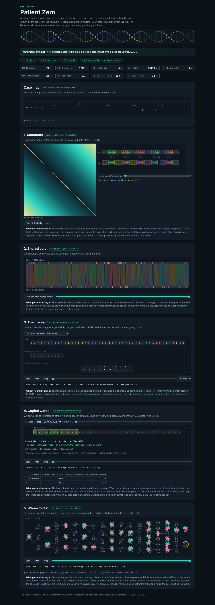

# Assignment 4. Patient Zero

Student ID: 252692
Name: Kaisar
Group: SE-2511

This file is the report. Fill it in as you go. How to start: `START_HERE.md`. The task: `docs/Assignment4.pdf`.

## Program output

The 9 lines your program prints on your data (`java -cp out Main`):

    Mutations: 108
    Shared core: 1212
    Marker hits: 4
    First hit: 13113
    Border length: 4
    Shared words: 459
    Tests needed: 31
    Cheapest testing: 118
    Longest chain: 23

My outbreak report (a screenshot of `output/outbreak.html`):

## Questions

Answer in your own words, two or three sentences each.

Mission 1. What does the cell d[i][j] of your table mean, and how is it computed from other cells?

d[i][j] is the smallest number of changes to turn the first i letters of A into the first j letters of B. It is the min of three cells: d[i-1][j-1] (+1 if the letters differ, +0 if they are the same), d[i-1][j]+1 for a delete and d[i][j-1]+1 for an insert. Row 0 and column 0 are just 0,1,2,... because you have to insert or delete everything.

Mission 2. How is the longest common subsequence different from the longest common substring? My Shared core is bigger than the number of letters that are the same at the same place: why?

A substring has to be letters next to each other, a subsequence only has to keep the order, so it can skip letters. Comparing letter by letter at the same place breaks after the first insert or delete because everything shifts by one, while LCS can jump over the inserted letter and keep matching, so it finds more.

Mission 3. What does the prefix function tell you, and why does the pointer in the text never go back in KMP? What is the Border length of my marker and what does it mean?

pi[i] is the length of the longest piece at the start of p[0..i] that is also at its end. On a mismatch KMP already knows those letters match the start of the marker, so it moves k to pi[k-1] and does not read the text again, that is why i only goes forward. My marker is AGCTCTAGCT and its Border length is 4: it starts and ends with AGCT, so two hits can overlap by 4 letters.

Mission 4. Why must you compare the letters after the hashes are equal? What happens to the cost of Rabin-Karp if many windows have the same hash?

Different words can get the same number modulo MOD, so equal hash does not mean equal word, without the check I would count false hits. If many windows share a hash, every lookup has to compare k letters with many candidates, so it goes from about O(n+m) to O(n*m*k) in the worst case.

Mission 5. What are the two states of a person in your DP, and how do you get the answer for a person from its children? Why does a greedy "test the person with most links first" not always give the cheapest answer?

For every person v I keep yes[v] (v tested, cost of the whole subtree) and no[v] (v not tested). yes[v] = cost[v] + sum of min(yes[c], no[c]), and no[v] = sum of yes[c], because if v is not tested every link to a child must be covered by the child. Greedy only looks at the number of links and ignores the cost, for example a center with 3 leaves where the center costs 100 and each leaf 1: greedy pays 100, the best is 3.

## AI use

The syllabus requires you to say which AI tools you used and for what. Write the tool (ChatGPT, Copilot, other) and what you asked it: explain an idea, find an error, review code. Write "none" if you did not use any. If you took code or text from a book or a website, give the source here.

Claude (Anthropic): I used it to explain the ideas and to review my code and README answers. I checked all of it with `java tools/Check.java` and on the lab console. The algorithms follow the lecture slides, no other sources.

## Timing (Mission 7)

Milliseconds, average of 3 runs, from `java -cp out Bench`.

| test | size | time |
|---|---|---|
| naive search | 20 000 / 40 000 / 80 000 | 27.6 / 25.4 / 52.4 |
| KMP | 20 000 / 40 000 / 80 000 | 2.0 / 0.8 / 0.4 |
| edit distance | 500 / 1000 / 2000 / 4000 | 4.8 / 8.4 / 21.1 / 100.8 |

What do the numbers say about how the time grows? When you double the size, by how much does each time grow? Two or three sentences.

Naive search is O(n*m) here and roughly doubles from 40 000 to 80 000 (the first run is slower because of JIT warm-up). KMP is linear and so fast that the numbers are mostly noise, it even gets faster as Java warms up. Edit distance is O(n^2), so doubling the length gives about 4 times more time (2000 -> 4000 is 21 -> 101 ms).

## Complexity

n is the length of the text (or of a strain), m the length of the pattern, k the length of the window, v the number of people. Fill in every algorithm you wrote.

| algorithm | time | space | assumptions |
|---|---|---|---|
| Edit distance | O(n·m) | O(n·m) | full table, both strains about n |
| LCS | O(n·m) | O(n·m) | same table as edit distance |
| Prefix function and KMP | O(n + m) | O(m) | k goes back at most as many times as it went forward |
| Rabin-Karp (shared words) | O(n + m) expected, O(n·m·k) worst | O(m) | few hash collisions with MOD = 10^9+7 |
| Tree DP | O(v) | O(v) | each person and link visited a constant number of times |

## Before you submit

- The four files in `data` and the screenshot `output/outbreak.png` are in the repository.
- `java tools/Check.java` shows all examples right.
- This README is filled in, the program output and the section AI use included.
- The work is pushed to main (at least one commit per mission) and the repository is public.
- The link is attached in Moodle.
